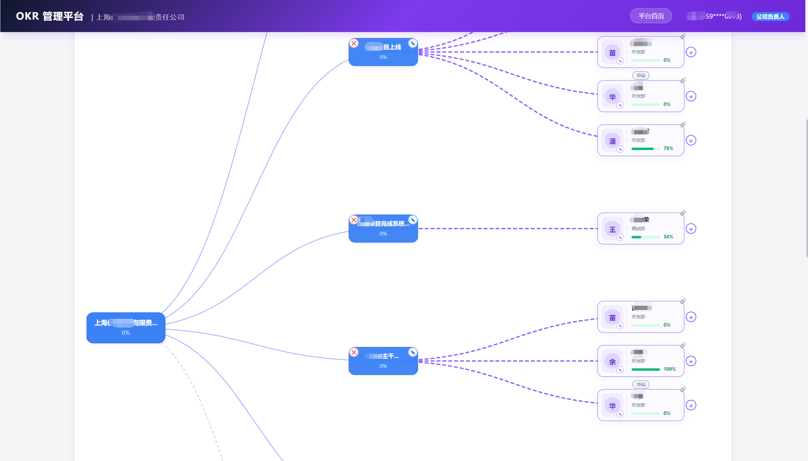
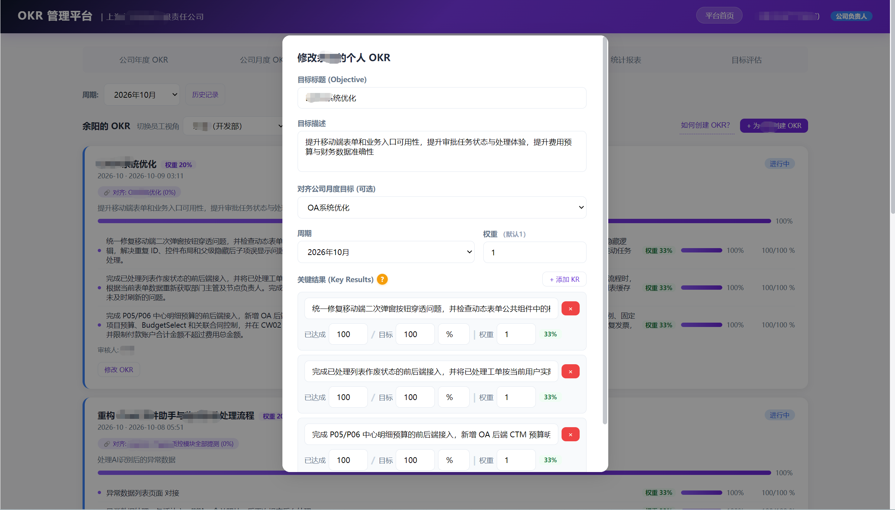
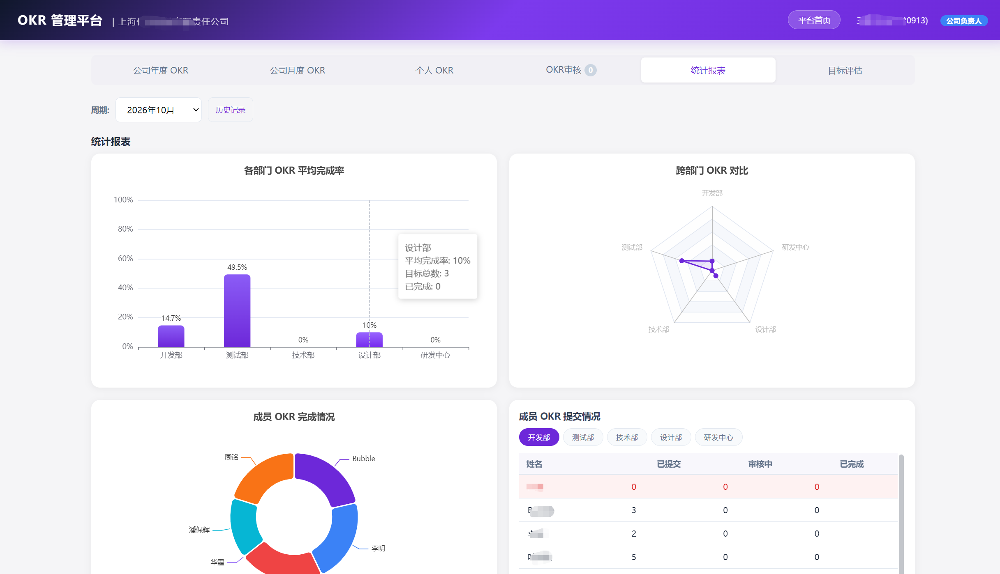
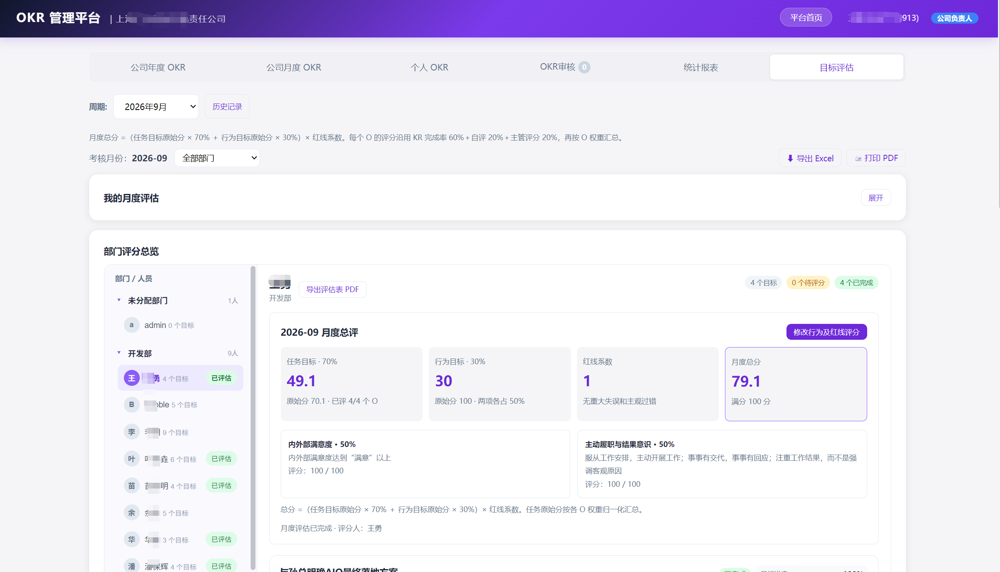
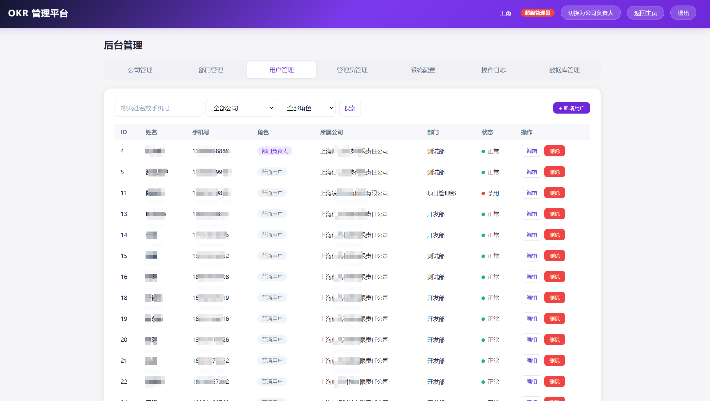

# iTrial OKR

把公司目标、个人执行和月度评估放进同一套工作流。

iTrial OKR 是一个可自托管的企业 OKR 管理系统，基于 **FastAPI + SQLite + 原生 HTML/CSS/JavaScript**。支持公司与个人目标对齐、KR 进度、审批、可视化看板和月度评估，也可通过 `okr.public` 集成到现有 FastAPI 应用。前端无需 Node.js 构建。

[适用场景](#适用场景) · [核心功能](#核心功能) · [快速开始](#快速开始) · [部署](#部署) · [企业微信配置](#企业微信配置) · [短信配置](#短信配置) · [常见问题](#常见问题) · [功能截图](#核心功能截图)

## 适用场景

| 使用者 / 场景 | 可以怎样使用 |
| --- | --- |
| 公司和部门负责人 | 拆解公司年度、月度目标，查看个人目标与公司目标的对齐关系，跟进部门执行情况。 |
| 项目与业务团队 | 为个人目标设置可量化 KR、目标值和权重，通过提交、审批和进度更新协作。 |
| 负责月度评估的管理者 | 汇总自评、主管评分、行为目标和红线系数，查看成员月度结果并导出评估表。 |
| 希望自行掌握配置和数据的团队 | 在自己的电脑或服务器运行，使用本地 SQLite 保存业务数据，通过企业微信接入组织身份。 |

当前采用单个应用实例与 SQLite 的部署形态，适合从中小型团队的内部目标管理起步。每个实例配置一套企业微信应用；系统的多公司管理与企业微信接入数量是两个配置维度。

## 核心功能

| 能力 | 具体功能 |
| --- | --- |
| 目标规划与对齐 | 公司年度 / 月度目标、个人目标、周期管理、目标权重及对齐关系。 |
| KR 与进度 | 设置当前值、目标值、单位和权重，计算 KR 与目标进度。 |
| 审批协作 | 目标提交、审核、驳回、撤回，以及相应权限和状态控制。 |
| 可视化看板 | 目标脑图、部门完成率、跨部门对比、成员完成与提交统计。 |
| 月度评估 | 逐 O 自评和主管评估、成员行为评分、红线系数、月度汇总、Excel / 打印 / 中文 PDF 导出。 |
| 组织与身份 | 多公司、部门、成员管理，企业微信授权登录，首次短信验证手机号，服务端角色与公司范围校验。 |
| 后台管理 | 用户、角色、公司 / 部门负责人、系统配置及操作审计。 |

当前评分规则：

- **单个 O 得分** = 自评 × 20% + 主管评分 × 80%；KR 完成率继续展示，不参与此项计分。
- **成员月度总分** =（按 O 权重汇总的任务分 × 70% + 行为分 × 30%）× 红线系数。

## 快速开始

先启动应用并检查健康状态，再完成企业微信与短信配置。**普通成员登录需要这两项集成均可用；只启动服务还不能完成成员登录。**

### 1. 获取代码

需要 Git，以及 Python 3.12 / 3.13。仅使用 Docker 的读者可在获取代码后直接前往 [Docker](#docker)。

```sh
git clone https://github.com/huevan/itrial-okr.git
cd itrial-okr
```

### 2. 安装依赖、初始化并启动

Windows PowerShell：

```powershell
python -m venv .venv
.\.venv\Scripts\python.exe -m pip install -r requirements.txt
.\.venv\Scripts\python.exe scripts/setup.py
.\.venv\Scripts\python.exe -m uvicorn app:app --host 127.0.0.1 --port 8888
```

Linux / macOS：

```sh
python3 -m venv .venv
.venv/bin/python -m pip install -r requirements.txt
.venv/bin/python scripts/setup.py
.venv/bin/python -m uvicorn app:app --host 127.0.0.1 --port 8888
```

初始化时输入管理员手机号和密码：手机号为以 1 开头的 11 位号码，密码至少 12 个字符，密码输入不回显。建议初始化管理者使用本人后续可接收验证短信的手机号，便于与企业微信账号关联。

自动化初始化支持 `OKR_BOOTSTRAP_PHONE`、`OKR_BOOTSTRAP_PASSWORD`，可由部署秘密存储注入，避免将实际凭据写进命令历史或仓库。

初始化生成：

| 文件 | 用途 |
| --- | --- |
| `config.json` | 本机配置及随机 JWT 密钥；由 [config.example.json](config.example.json) 生成。 |
| `data/okr.db` | SQLite 业务数据库及初始化管理员账号。 |

**初始化只执行一次。** 检测到配置或数据库已存在时，脚本会停止；正常启动和升级复用已有文件。仓库不提供通用默认密码。

### 3. 检查服务

| 入口 | 地址 |
| --- | --- |
| OKR 页面 | <http://127.0.0.1:8888/okr> |
| 企业微信登录 | <http://127.0.0.1:8888/okr/login> |
| 后台管理 | <http://127.0.0.1:8888/okr/admin> |
| API 文档 | <http://127.0.0.1:8888/docs> |
| 健康检查 | <http://127.0.0.1:8888/healthz> |

健康接口应返回 `{"status":"ok"}`。PowerShell 可运行：

```powershell
Invoke-RestMethod http://127.0.0.1:8888/healthz
```

Linux / macOS 可运行 `curl -f http://127.0.0.1:8888/healthz`。

未配置企业微信时，登录页提示配置缺失是预期行为。初始化管理员的密码入口是 `POST /api/okr/auth/login`，请求字段为 `phone`、`password`，成功返回供 API 客户端使用的 Bearer Token；网页登录页仍走企业微信，普通成员密码登录和公开注册均已停用。

## 部署

### Docker

需要 Docker 与 Docker Compose。以下命令均在仓库根目录运行。

**首次初始化：** 已按 Python 方式生成 `config.json` 和 `data/` 的读者，直接进行文件权限检查和启动即可。仅有 Docker 的环境先构建初始化用镜像：

```sh
docker build -t itrial-okr:local .
```

Windows PowerShell 使用一次性容器初始化：

```powershell
docker run --rm -it --user root --mount "type=bind,source=$($PWD.Path),target=/app" itrial-okr:local python scripts/setup.py
```

Linux / macOS 使用：

```sh
docker run --rm -it --user root --mount "type=bind,source=$(pwd),target=/app" itrial-okr:local python scripts/setup.py
```

该步骤在主机仓库中生成配置和数据库，并交互询问管理员信息；服务镜像默认以 UID 10001 运行。

**Linux 主机权限：** 为容器 UID 10001 设置本项目配置与数据目录的访问权限：

```sh
sudo chown 10001:10001 config.json
sudo chmod 600 config.json
sudo chown -R 10001:10001 data
sudo chmod 700 data
```

Windows / macOS Docker Desktop 的绑定挂载权限由主机环境管理；上述 Linux 权限命令用于 Linux 服务器。后续编辑 Linux 上的配置，可使用 `sudoedit config.json`。

**启动并检查：**

```sh
docker compose up -d --build
docker compose ps
docker compose logs --tail=80 okr
```

Compose 会构建服务镜像，以只读方式挂载 `config.json`，并将 `data/` 持久化到主机。默认端口为 `127.0.0.1:8888:8888`；如已被占用，将 [compose.yaml](compose.yaml) 中的主机端口改为例如 `127.0.0.1:8898:8888`，然后使用对应地址访问。

### 服务器域名与 HTTPS

默认 Compose 端口只接受服务器本机连接。对外提供服务时：

1. 准备可由成员浏览器访问的域名并配置 HTTPS，例如 `https://okr.example.com`。
2. 通过服务器上的反向代理将站点流量转发到 `http://127.0.0.1:8888`。
3. 将这个 HTTPS 域名用于下文的企业微信可信域名、授权回调域和完整回调 URL。

在已配置域名与证书的 Nginx HTTPS 站点中，反向代理部分可使用：

```nginx
location / {
    proxy_pass http://127.0.0.1:8888;
    proxy_set_header Host $host;
    proxy_set_header X-Forwarded-Proto $scheme;
    proxy_set_header X-Forwarded-For $proxy_add_x_forwarded_for;
}
```

浏览器图表与 Excel 导出当前从 CDN 加载 D3、ECharts 和 SheetJS，浏览器需要能够访问相应 CDN。服务器需要能通过 HTTPS 访问 `qyapi.weixin.qq.com` 和 `sms.tencentcloudapi.com`，用于身份读取和短信发送。

### 配置生效、升级与备份

- 在初始化生成的 `config.json` 中填写集成配置，保留已有 `jwt_secret`。更换 JWT 密钥会使已有登录令牌失效。
- 保存配置后，本机 Python 服务可停止后按原命令重新启动；Docker 使用 `docker compose up -d --force-recreate okr`，重新载入挂载和环境变量。
- 升级前备份代码版本、`config.json` 与整个 `data/`。需要文件级一致性备份时，先运行 `docker compose stop okr`，完成备份后再启动。配置备份也应按秘密文件保管。
- 更新代码后运行 `docker compose up -d --build`，复查健康接口和登录。恢复时使用同一快照中的配置与数据。

## 企业微信配置

本项目使用**企业自建应用**：桌面浏览器进入扫码登录，企业微信客户端进入网页授权；授权后读取当前成员及其部门信息，并在本地创建或关联账号。

### 1. 创建应用并取得配置项

在 [企业微信管理后台](https://work.weixin.qq.com/) 的“应用管理 → 自建”中创建或选用应用。将需要使用 OKR 的成员、部门及其负责人纳入应用可见范围，并确认应用具有读取所需成员和部门资料的权限。

| 本项目字段 | 在企业微信哪里查找 |
| --- | --- |
| `corp_id` | “我的企业”中的企业 ID（CorpID）。 |
| `agent_id` | 当前自建应用详情中的 AgentId。 |
| `app_secret` | 同一自建应用的 Secret。 |

以上三项须来自同一个企业及应用。后台菜单与域名校验流程可对照腾讯官方的 [企微认证配置说明](https://cloud.tencent.com/document/product/1831/138263)。

### 2. 配置域名、回调与企业可信 IP

以站点 `https://okr.example.com` 为例：

| 位置 | 填写内容 |
| --- | --- |
| 企业微信“网页授权及 JS-SDK → 设置可信域名” | `okr.example.com`，按后台要求完成域名校验。 |
| 企业微信“企业微信授权登录 → Web 网页 → 授权回调域” | `okr.example.com`，供桌面端授权登录使用。 |
| 本项目 `okr.wecom.callback_url` | 完整 URL：`https://okr.example.com/api/okr/auth/wecom/callback`。 |
| 企业微信“企业可信 IP” | 实际后端访问企业微信 API 时使用的出口公网 IP；经过 NAT 时填写出口地址。 |
| 自建应用主页（需要工作台入口时） | `https://okr.example.com/okr/login`。 |

域名字段按管理后台要求填写域名，完整回调路径保存在本项目配置中。域名校验文件需要由站点根路径提供时，在反向代理站点配置其访问位置。此处使用 OAuth 登录回调，应用的“接收消息服务器”配置与该登录流程无关。

桌面授权回调域与网页可信域名的后台位置，也可参考腾讯官方的 [企业微信扫码登录说明](https://cloud.tencent.com/document/product/1441/107281)。

### 3. 填写本项目配置

编辑初始化生成的 `config.json`，只修改其中的 `okr.wecom` 对象，保留文件其余内容。下面三个空字符串填入上一步获得的值：

```json
{
  "enabled": true,
  "corp_id": "",
  "agent_id": "",
  "app_secret": "",
  "callback_url": "https://okr.example.com/api/okr/auth/wecom/callback",
  "corp_name": "示例企业",
  "leader_role": "dept_head"
}
```

- `corp_name` 用于本地公司匹配与创建，改为自己的公司名称。
- 已有 OKR 公司时，可在此对象中增加整数 `company_id`，明确绑定已核对的公司；不填写时，系统按 CorpID / 公司名称查找，未找到则创建公司。
- `leader_role` 控制企业微信识别出的部门负责人取得的基础角色，可选 `dept_head`、`admin`、`superAdmin`。上例选择 `dept_head`；仓库配置模板的默认值为 `superAdmin`，会赋予相应负责人超级管理员角色，上线前应按实际管理范围确定。
- 公司负责人还需要本地公司上的负责人任命关系，可在后台公司管理中指定。

### 4. 检查本地配置，再进行真实授权

保存配置并按 [配置生效](#配置生效升级与备份) 的方式重新载入服务，然后访问：

```text
GET https://okr.example.com/api/okr/auth/wecom/options
```

应看到 `enabled=true`、`configured=true`，并核对返回的 `callback_url`。**这只说明本地开关已打开且必填项非空，不验证企业微信凭据、可信域名、接口权限或短信服务。**

接下来先完成短信配置，再从 `https://okr.example.com/okr/login` 发起一次新的授权流程，保留同一域名与浏览器的登录 Cookie。

## 短信配置

首次企业微信登录后，成员必须通过真实短信验证码完成手机号绑定，之后才能访问业务接口。当前手机号校验面向中国大陆 11 位号码。

1. 在腾讯云短信控制台准备短信应用、审核通过的签名和验证码模板，并为服务端凭据授予所需短信发送权限。
2. 编辑 `config.json` 中的 `okr.sms` 对象，填写以下配置：

```json
{
  "secret_id": "",
  "secret_key": "",
  "sdk_app_id": "",
  "sign_name": "",
  "template_id": "",
  "template_params": "code",
  "code_ttl_minutes": 5,
  "region": "ap-guangzhou"
}
```

| 字段 | 填写要求 |
| --- | --- |
| `secret_id` / `secret_key` | 腾讯云服务端 API 凭据，仅保存在本地配置或部署秘密存储中。 |
| `sdk_app_id` | 腾讯云短信应用的 SDKAppID。 |
| `sign_name` | 已审核通过的短信签名文字。 |
| `template_id` | 已审核通过的验证码模板 ID。 |
| `template_params` | 按模板变量顺序填写：单验证码变量用 `code`，验证码与有效分钟数两个变量用 `code,ttl`。 |
| `code_ttl_minutes` / `region` | 验证码有效分钟数与短信区域；有效期默认 5 分钟，代码支持 1–30 分钟。 |

模板参数数量与顺序必须与已审核模板一致，参见 [腾讯云 SendSms 文档](https://cloud.tencent.com/document/product/382/55981)。保存后重新载入服务，在实际登录流程中发送并验证一次短信，确认供应商账号和模板都可用；该操作使用部署方自己的短信服务。

## 首次登录与使用

1. 管理者从 `/okr/login` 完成企业微信授权，并验证初始化时使用的同一手机号，以关联初始化管理员账号。
2. 核对当前角色；同时具有负责人身份和超级管理员角色的账号可通过页面角色切换进入后台管理。
3. 在后台核对公司、部门与成员，指定公司负责人，并确认部门负责人和成员归属。组织资料随相关成员登录时同步，不是后台定时全量导入。
4. 创建公司年度 / 月度目标，再创建个人目标与 KR，设置对齐关系和权重，按权限提交与审核。
5. 更新进度并查看看板；评估周期内完成自评、主管评估、行为和红线评分，查看汇总或导出评估表。

若企业微信没有返回手机号，可在短信绑定页输入初始化时的同一手机号；绑定成功后系统会关联相应的历史账号。初始化管理员的密码 API 用于应急维护，不替代上述普通成员登录流程。

## 环境变量

默认方式是填写 `config.json`。企业微信和短信的下列环境变量可覆盖对应文件字段：

<details>
<summary>展开环境变量与配置字段对照表</summary>

| 配置对象 | 文件字段 | 环境变量 |
| --- | --- | --- |
| `okr.wecom` | `enabled` | `OKR_WECOM_ENABLED` |
| `okr.wecom` | `corp_id` | `OKR_WECOM_CORP_ID` |
| `okr.wecom` | `agent_id` | `OKR_WECOM_AGENT_ID` |
| `okr.wecom` | `app_secret` | `OKR_WECOM_APP_SECRET` |
| `okr.wecom` | `callback_url` | `OKR_WECOM_CALLBACK_URL` |
| `okr.wecom` | `corp_name` | `OKR_WECOM_CORP_NAME` |
| `okr.wecom` | `company_id` | `OKR_WECOM_COMPANY_ID` |
| `okr.wecom` | `leader_role` | `OKR_WECOM_LEADER_ROLE` |
| `okr.sms` | `secret_id` / `secret_key` | `TENCENTCLOUD_SECRET_ID` / `TENCENTCLOUD_SECRET_KEY` |
| `okr.sms` | `sdk_app_id` | `TENCENT_SMS_SDK_APP_ID` |
| `okr.sms` | `sign_name` | `TENCENT_SMS_SIGN_NAME` |
| `okr.sms` | `template_id` | `TENCENT_SMS_TEMPLATE_ID` |
| `okr.sms` | `template_params` | `TENCENT_SMS_TEMPLATE_PARAMS` |
| `okr.sms` | `code_ttl_minutes` | `TENCENT_SMS_CODE_TTL_MINUTES` |
| `okr.sms` | `region` | `TENCENT_SMS_REGION` |

Python 进程直接读取它所继承的环境变量。如使用 `.env`，需通过 Uvicorn 的 `--env-file .env` 等方式显式载入。

Compose 默认文件没有 `env_file` 或集成凭据的 `environment` 配置；主机环境变量和项目 `.env` 不会自动全部注入容器。需要使用环境文件时，在 `services.okr` 下增加 `env_file`，保留原来的 `build`、`ports`、`volumes` 等配置：

```yaml
services:
  okr:
    env_file:
      - .env
```

随后运行 `docker compose up -d --force-recreate okr`。真实 `.env` 与 `config.json` 都不应提交到 Git。

</details>

## 常见问题

| 现象 | 优先检查 |
| --- | --- |
| 登录页提示“企业微信登录尚未完成服务器配置” | 检查 `enabled` 与三项凭据是否填写，以及环境变量是否覆盖了文件；用 `/api/okr/auth/wecom/options` 查看本地状态。 |
| 扫码后提示回调域或可信域名不匹配 | 对照浏览器域名、企微两处域名配置及完整 `callback_url`；确认域名校验已完成。 |
| `gettoken`、`user/get` 或 `department/list` 失败 | 检查同一应用的 CorpID / Secret、应用可见范围、接口权限、后端出口可信 IP 和网络；保留脱敏后的供应商错误信息排查。 |
| 提示登录状态失效 | 从 `/okr/login` 重新发起授权，保持域名一致并允许登录 Cookie，避免复用旧授权链接。 |
| 短信无法发送或模板参数错误 | 核对 SDKAppID、签名文字、模板审核状态、变量数量 / 顺序、发送权限及短信服务状态。 |
| 能授权但业务接口返回“请先通过短信验证码绑定手机号” | 继续完成首次手机号验证；企业微信授权成功与业务访问权限是两个阶段。 |
| 密码登录或注册返回 410 | 普通成员使用企业微信；仅初始化的超级管理员有应急密码 API，公开注册已取消。 |
| Docker 提示配置或数据库权限不足 | 确认 `config.json` 是文件、挂载路径正确，Linux 下 UID 10001 能读取配置并写入 `data/`。 |
| 环境变量改了但容器仍使用旧值 | 检查 `env_file` / `environment`，再重新创建服务容器。 |
| 初始化提示文件已存在，或端口 8888 被占用 | 已初始化的实例直接启动；端口冲突时调整主机端口并使用相应访问地址。 |

## 核心功能截图

以下为维护者提供的既有部署界面截图，部分信息已打码，原图保留。图中组织、成员和统计属于截图所示环境，并非项目内置演示数据。

### 目标对齐与脑图



### 个人 OKR 与 KR 编辑



### 统计报表



### 成员月度评估

**历史界面说明：此图内单 O 评分文字属于旧版本。当前代码采用“自评 20% + 主管评分 80%”，KR 完成率不参与计分；任务 70%、行为 30% 和红线系数规则保持。**



### 后台用户管理



## 目录与集成

```text
app.py                    # 独立应用：生命周期、路由、静态资源
okr/
  public.py               # 对外集成入口
  api.py                  # OKR API 与页面路由
  auth.py / models.py     # 鉴权与请求校验
  db.py / paths.py        # SQLite 与资源路径
  evaluation*.py          # 月度评估、评分与 PDF
  progress.py             # 进度规则
  wecom.py / sms.py       # 企业微信与短信适配器
static/okr/               # 页面、JS、CSS
tests/                    # 隔离 SQLite 与供应商 mock 回归
scripts/                  # 初始化与质量检查
docs/screenshots/         # 功能截图
okr_*.py                  # 历史导入兼容别名
```

宿主可从 `okr.public` 导入 `okr_router`、`init_db`，在生命周期调用初始化、注册路由，并挂载 `/static/okr`。配置、数据库和静态资源相对于项目根目录定位。

## 验证

使用对应虚拟环境的 Python 运行：

```sh
python -m pip check
python scripts/verify.py
```

验证脚本检查架构、发布安全和语法，再通过临时配置、临时 SQLite 与 mock 供应商运行 OKR 测试，不调用真实企业微信或短信，不覆盖本地配置。严格静态类型检查尚未建立。

原有 `/okr`、`/api/okr/*` 契约保留；独立应用提供 `/` 跳转和 `/healthz`。仓库不包含实际部署配置、业务数据库、内部部署脚本或原平台 Git 历史。

## 开源许可

采用 [GNU AGPL-3.0](LICENSE)。PDF 使用 PyMuPDF，许可信息见 [PyMuPDF licensing](https://pymupdf.io/licensing)，并保留其生成的 PDF 元数据。其余依赖与许可证见 [THIRD_PARTY_NOTICES.md](THIRD_PARTY_NOTICES.md)。

问题反馈与部署安全说明见 [SECURITY.md](SECURITY.md)，开发和验证记录见 [docs/status.md](docs/status.md)。贡献前请运行验证脚本，并保持接口、权限、公司隔离和评分规则。
